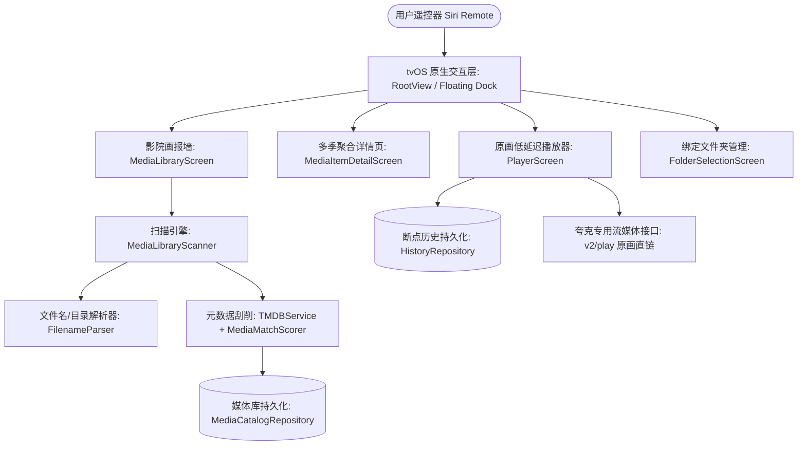

# Quark Theater (Theater) tvOS 项目完整交接文档

> **文档创建时间**：2026-10-17  
> **文档版本**：v2.1  
> **适用对象**：接手本项目继续开发、维护、测试或打包分发的工程师

---

## 目录
1. [工作区目录与开发环境](#1-工作区目录与开发环境)
2. [项目整体架构与设计玩法](#2-项目整体架构与设计玩法)
3. [项目文件职责详查清单](#3-项目文件职责详查清单)
4. [已完成核心工作与填坑记录](#4-已完成核心工作与填坑记录)
5. [当前未决事项与接手待办指南（重点：高堡奇人第四季修复）](#5-当前未决事项与接手待办指南)
6. [打包、自签与 Apple TV 真机部署指南](#6-打包自签与-apple-tv-真机部署指南)

---

## 1. 工作区目录与开发环境

### 1.1 关键路径
* **本地工作区根目录**：  
  `/Users/wangbin/Documents/antigravity/zealous-darwin/quark-theater`
* **Xcode 工程文件**：  
  `/Users/wangbin/Documents/antigravity/zealous-darwin/quark-theater/QuarkTheater.xcodeproj`
* **Git 远程仓库**：  
  `https://github.com/aspiring132-bit/quark-theater.git` （当前主分支：`main`）
* **Apple TV 模拟器数据容器目录**（tvOS 27.0 模拟器 `Apple TV 4K (3rd generation) (at 1080p)`）：  
  UDID: `3B8F12B8-476E-4171-9665-F645F63D4660`  
  数据持久化路径：`~/Library/Developer/CoreSimulator/Devices/3B8F12B8-476E-4171-9665-F645F63D4660/data/Containers/Data/Application/`

### 1.2 编译与环境依赖
* **开发工具**：Xcode 27 Beta 6（或 Xcode 16+），tvOS 17.0+ 部署目标（当前测试在 tvOS 27.0 / tvOS 18 运行正常）。
* **编程语言**：Swift 6（已全面适配并发安全性、MainActor 隔离与 tvOS FocusState）。
* **项目标识配置**：
  * **Bundle Identifier**：`org.quarktheater.app.wangbin`
  * **App 显示名称**：`Theater`（已按需求去除“夸克”字眼）
  * **Development Team**：`SC922VXN5U`（个人免费 Apple ID 开发者证书）

---

## 2. 项目整体架构与设计玩法

Quark Theater 是一款**专为 Apple TV / tvOS 大屏打造的原生家庭私有私播影院**。它以夸克网盘为底层云存储，同时支持接入各类网盘源，自动完成影视剧海报、背景、演职员刮削，提供比肩 Netflix / Apple TV+ 的视听交互体验。



### 核心功能与玩法特点
1. **沉浸式画报墙（Cinema 展台）**：
   * **巨幕海报展台 (Hero Showcase)**：焦点移动至海报时，顶部自动展开动态大背景图、影片年份、TMDB 评分、剧情简介与“一键起播”/“选集速播”。
   * **悬浮拟物 Dock 导航**：类似 tvOS 动态 Dock，居中悬浮；向下滚动海报内容时**自动隐去**留出全景巨幕空间，向上滑动焦点时**自动重新浮现**。
2. **多季多集智能识别与合并（剧集玩法）**：
   * 自动将网盘中零碎的单集文件（如 `01.mp4`, `S02E03.mkv`）、不同目录（如 `Season 01`、`Season 02`）聚合在同一部电视剧名下。
   * 进入详情页提供高对比度【第 1 季】~【第 N 季】选择栏、每季集数网格、断点续播进度指示条。
3. **突破限速的原画视频流播放**：
   * 放弃常规下载/外链接口（常规接口会被夸克限制在 100KB/s 导致 4K 卡顿），全面采用专属客户端级 `/1/clouddrive/file/v2/play` 视频流接口，跑满家庭百兆/千兆带宽。
   * 自动设置 6GB 大缓冲区与 AVPlayer 自适应调优。
4. **tvOS 原生 Siri Remote 遥控器交互**：
   * 左右滑动触控板快进/快退并显示时码。
   * 播放时按【上方向键】唤出“多画质源与选集抽屉”，抽屉聚焦时不穿透背景，按【Back / <】即时关闭抽屉。
   * 全局支持按 Siri Remote【Back / <】返回上一级或一键回到影院展台。

---

## 3. 项目文件职责详查清单

| 目录 / 文件 | 核心职责与设计要点 |
| :--- | :--- |
| **App/** | |
| `QuarkTheaterApp.swift` | App 生命周期入口。初始化 Session、凭据存储（Keychain/Simulator 回退）、数据库仓储，设置全局黑色背景与环境对象注入。 |
| **Views/** | |
| `RootView.swift` | 根视图容器。承载顶层悬浮 Dock（影院、文件、历史、设置）与页面切换，提供全局 `.onExitCommand`（Siri Remote 返回键拦截与回退到 Cinema）。 |
| `MediaLibraryScreen.swift` | 影院主展台。包含顶部巨幕展台、横向筛选胶囊（全部/电影/电视剧、按名称/按年份）、海报网格、未匹配候选区、后台静默扫描与自动 TMDB 刮削流程。 |
| `MediaItemDetailScreen.swift` | 影视剧全屏详情页。展示高清背景海报、剧集多季 Tab 栏（高对比度选中态）、每季集数矩阵、播放/续播入口、重新匹配 TMDB 入口。 |
| `PlayerScreen.swift` | 全屏视频播放器。基于 AVPlayer，处理画质切换、播放进度记录、连续自动播放下一集、遥控器上下滑动手势抽屉、双层焦点隔离防穿透。 |
| `FolderSelectionScreen.swift` | 绑定网盘文件夹管理（多源管理）。支持从根目录多级面包屑向下穿透、任意子目录勾选/取消勾选、已绑定源列表快速移除与返回影院。 |
| `FileBrowserScreen.swift` | 原始网盘文件浏览器。用于直接浏览网盘目录树与起播未刮削的冷门视频。 |
| `HistoryScreen.swift` | 观看历史记录。展示断点续播进度百分比、最后观看时间、一键清空与直接续播。 |
| `LoginScreen.swift` | 登录与鉴权页。支持二维码扫码登录夸克、Cookie 手动写入，提供演示模式体验。 |
| `TMDBMatchScreen.swift` | 手动刮削匹配面板。允许用户在自动刮削不准确时输入自定义关键词搜索 TMDB 并指定绑定。 |
| **Media/** | |
| `MediaLibraryScanner.swift` | 网盘目录树递归扫描器。广度优先遍历绑定目录，记录每个文件的完整祖先路径（Ancestors），并将路径透传给解析引擎。 |
| `FilenameParser.swift` | 文件名与路径结构解析引擎。识别 `SxxExx`、`第X集`、纯数字（`01`、`10`）、破折号连字符（`0-1`），并自底向上解析提取剧名与季度。 |
| `TMDBService.swift` | TMDB API 客户端。提供影视剧搜索、季集详情查询、演职员与中文元数据抓取。 |
| `MediaMatchScorer.swift` | 候选词相似度匹配评分器。结合年份、标题相似度、父目录线索对 TMDB 候选结果进行打分排序（>58% 自动入库）。 |
| **Playback/** | |
| `PlaybackCoordinator.swift` | 播放状态机。协调播放初始化、缓冲监控、重试策略与进度回传。 |
| `PlaybackProbe.swift` | 播放流探测器。探测流媒体响应头、Cookie 携带情况与真实视频格式。 |
| `RetryPolicy.swift` | 网络抖动自动重试退避策略。 |
| **Repositories/** | |
| `MediaCatalogRepository.swift` | SQLite 本地媒体库仓储（`media-catalog.sqlite`）。管理 `media_catalog`（入库元数据）、`media_scan`（文件指纹树）、`media_favorites`。 |
| `HistoryRepository.swift` | SQLite 观看历史仓储（`watch-history.sqlite`）。记录每部影片的播放秒数、总时长与完成度。 |
| **Services/** | |
| `LiveQuarkClient.swift` | 夸克官方 OpenAPI 客户端。封装获取文件列表、视频流地址获取、文件重命名等接口。 |
| `MockQuarkClient.swift` | 本地 Mock 客户端，供单元测试与免登录演示。 |
| `QuarkHTTPTransport.swift` | 底层网络传输通道，配置 Cookie 与 User-Agent。 |
| `BoundFolderStore.swift` | 绑定文件夹持久化存储（基于 UserDefaults）。 |
| `CredentialStore.swift` / `TMDBCredentialStore.swift` | 凭据钥匙串存储，兼容模拟器 Fallback 机制。 |
| **Core/** | |
| `Models.swift` | 核心数据模型（`CloudFile`, `MediaItem`, `ParsedMediaName`, `MediaType` 等）。 |
| `QuarkClient.swift` | 夸克客户端抽象协议接口。 |
| `Diagnostics.swift` | 内存内运行诊断日志记录器。 |

---

## 4. 已完成核心工作与填坑记录

在近期的迭代与修复中，我们针对 Apple TV 大屏交互踩过的深坑做出了多次重要重构：

### 4.1 彻底解决 tvOS 遥控器焦点陷阱（Focus Traps）
* **痛点**：tvOS 的焦点系统（Focus Engine）只在同一焦点区域（Focus Section）内自动寻路。此前在【设置】和【绑定文件夹】中向下滑动后，焦点陷入底部无法向上穿透返回 Dock。
* **解法**：在 `RootView.swift` 中将 `dockContainer` 声明为 `.focusSection()` 且设置横向满宽 `frame(maxWidth: .infinity)`；在各子页面（设置、多源管理）显式添加顶部 `[← 返回影院]` 快捷按键，并在 `RootView` 中挂载 `.onExitCommand` 监听遥控器 Back 键。

### 4.2 退出登录死循环与 Dock 丢失修复
* **痛点**：在设置页点击“退出账号”后，由于 Tab 停留在 `.settings`，Dock 栏被隐藏，导致出现没有任何选项的纯黑空屏。
* **解法**：将 `selectedTab` 从持久化恢复为初始化为 `.media`，退出登录时强制执行 `onBackToCinema()` 重置回影院主屏并呼出登录框。

### 4.3 目录穿透与多级祖先路径透传（BUG-005）
* **痛点**：对于网盘常见的嵌套格式（例如 `来自：分享 / G 高堡奇人S01~S04 / Season 04 / 01.mp4`），旧逻辑只拿最内层目录名 `Season 04` 去 TMDB 搜索，导致无法搜到电视剧名。
* **解法**：`MediaLibraryScanner` 升级为带 `path: [String]` 的树级扫描器，记录从根目录开始的所有祖先节点；`FilenameParser.extractShowAndSeason(fromPath:)` 能够剥离 `G `、`S ` 等分享站前缀，准确提取出剧集真实名称 `高堡奇人` 与季度 `4`。

---

## 5. 当前未决事项与接手待办指南

### 5.1 【最高优先级】《高堡奇人》第四季 missing 问题剖析与修复指引

#### 问题表现
在《高堡奇人》详情页中，当前只展示了：
* `第 1 季 (10集)`
* `第 2 季 (10集)`
* `第 3 季 (10集)`
* **第 4 季消失**（总共 40 个文件，第 4 季的 10 个文件 `01.mp4` ~ `10.mp4` 未入库）。

#### 数据库实地排查结论
经排查模拟器 SQLite 数据库：
1. `media_scan` 表中，第四季的 10 个文件均已成功扫描记录：
   * 文件 ID：`92c9fa36...`, `f667e85c...`, `8b1a4ebc...`, `11164ce9...`, `facd129c...`, `ed54998c...`, `f2f9d802...`, `5b9509f0...`, `daeaa9a1...`, `39c1b275...`
   * 文件名：`01.mp4`, `02.mp4` ... `10.mp4`
   * 父目录 ID：`7950103ad7c44f47ac3618c0d0f7d13b`（即 `Season 04` 目录）
2. 但在 `media_catalog` 表中，**这 10 个文件没有入库记录**！

#### 根本原因定位
在 `MediaLibraryScreen.swift` 的 `autoMatchUnmatched` 中：
```swift
let groups = Dictionary(grouping: unconfirmed, by: { "\($0.parsedName.mediaType.rawValue):\($0.parsedName.title.lowercased())" })
```
当第四季文件为纯数字 `01.mp4` 时：
1. 在 `FilenameParser.parse` 中：
   ```swift
   let effectiveTitle = detectedShowTitle ?? folderTitle(parentFolderName) ?? base
   ```
   如果 `detectedShowTitle` 在某一层没有成功继承到，就会调用 `folderTitle("Season 04")`，而 `folderTitle("Season 04")` 去掉 Season 关键字后变成了空串（返回 `nil`），于是 `effectiveTitle` 兜底成了 `base`（即 `"01"`）。
2. `"01"` 作为 title 去 TMDB 搜索，匹配评分不足 0.58，导致这 10 个候选文件被丢弃在 `unmatchedCandidates` 中，没有存入 `confirmed`。
3. `MediaItemDetailScreen` 中只过滤已确认的条目（`related = confirmed.filter { $0.tmdbId == detailItem.tmdbId }`），因而第四季完全缺失。

#### 接手人的修复方案建议
1. **完善祖先查找**：在 `MediaLibraryScanner.swift` 中，确保对每个文件向上追溯祖先路径时，若父目录为 `Season XX`，必定向上取到所属剧集目录名（如 `G 高堡奇人S01~S04` -> `高堡奇人`），确保 `detectedShow` 不为 `nil`。
2. **季号兜底关联**：在 `MediaLibraryScreen.swift` 的 `autoMatchUnmatched` 匹配或者详情页组装时，如果某个未确认候选文件的祖先或父目录包含已确认剧集的名称，允许将其直接绑定至该剧集，无需重新请求 TMDB 接口。
3. **在详情页显示未刮削候选**：在 `MediaItemDetailScreen` 中，可将属于同一物理目录但未刮削的文件作为对应季的备选列表展示，避免用户完全看不到文件。

---

## 6. 打包、自签与 Apple TV 真机部署指南

### 6.1 命令行编译与打包指令
在工作区根目录下执行：
```bash
cd /Users/wangbin/Documents/antigravity/zealous-darwin/quark-theater

# 1. 编译 tvOS Release 版
xcodebuild clean archive \
  -scheme QuarkTheater \
  -destination 'generic/platform=tvOS' \
  -archivePath ./build/QuarkTheater.xcarchive \
  -allowProvisioningUpdates

# 2. 导出为未签名的 Payload / App
mkdir -p ./build/Payload
cp -r ./build/QuarkTheater.xcarchive/Products/Applications/QuarkTheater.app ./build/Payload/Theater.app
cd ./build
zip -r Theater.ipa Payload
```

### 6.2 Xcode 真机无线部署（Apple TV 无 USB 口）
1. 确保 Mac 与 Apple TV 处于同一局域网 Wi-Fi。
2. 在 Apple TV 设置中：【设置】➡️【通用】➡️【遥控器与设备】➡️【远程应用程序与设备】。
3. 在 Mac 打开 Xcode：菜单栏【Window】➡️【Devices and Simulators】（快捷键 `Shift + ⌘ + 2`）。
4. 在左侧列表中找到带有配对图标的 Apple TV，点击并输入 Apple TV 屏幕显示的 6 位验证码完成无线配对。
5. 配对成功后，在【INSTALLED APPS】下方点击 `+` 号，选择编译出的 `Theater.app` 或 `Theater.ipa` 即可直接安装到电视。

> **自签证书有效期须知**：个人免费 Apple ID 自签有效期为 **7 天**；如需长期使用，建议接手人绑定 Apple Developer Program 付费开发者账号（有效期 1 年）或使用 TestFlight 进行无线推送测试。
