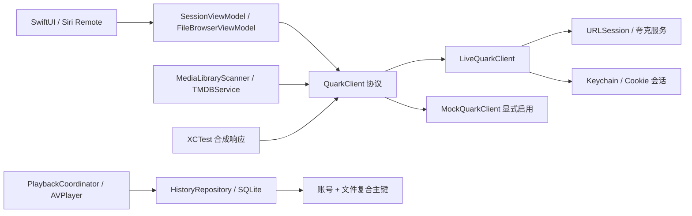

# 架构说明

## 依赖方向

视图只通过 ViewModel 发出操作。协议隔离真实接口和 Mock；Mock 必须显式启用。网络适配负责外部字段映射与错误分类，ViewModel 负责等待、取消、分页及用户可见状态。会话和 UI 在 MainActor 串行管理，网络通过 URLSession 异步执行，不在主线程阻塞等待。

## 目录

- `App/`：应用入口、scene 生命周期。
- `Core/`：协议、领域模型、可向用户显示的错误、有限且脱敏的诊断。
- `Services/`：已核实接口、HTTP 处理、Cookie 和 Keychain、显式 Mock。
- `ViewModels/`：登录轮询和取消；目录栈、分页及重复页防护。
- `Views/`：首页、登录、网盘搜索、播放器、历史、设置和诊断。
- `Media/`：递归扫描、文件名解析、TMDB 搜索和保守候选评分。
- `Repositories/`：账号隔离的 SQLite 历史、已确认 TMDB 匹配与收藏。
- `Playback/`：AVPlayer 协调器、Range 探测和有限重试策略。
- `QuarkTheaterTests/`：XCTest。
- `scripts/`：确定性项目生成和静态验证工具。

## 身份和存储

API 源码没有足够证据证明稳定的服务端账号 ID 格式。第一轮为每次成功登录创建本地 accountId，并与 Cookie 一起保存在 Keychain；恢复同一份凭据保持相同分区。重新扫码可能产生新分区，暂不能宣称跨登录历史自动合并。这样优先保证不同账号不串记录。

SQLite 主键为 `(account_id, file_id)`，通过参数绑定访问。模型中的 `CloudFile.fileExtension` 对应任务书的 extension 字段，避免与 Swift 关键字混淆。扫描、名称解析、TMDB 查询服务和候选评分已实现；已确认匹配写入账号/文件复合键 SQLite 缓存，但完整影视墙/详情体验尚未实现。低于高置信度门槛的候选不得自动确认。

播放 URL 是临时资源，`PlaybackSession` 和 `PlaybackResource` 不做持久化；数据库只允许历史进度等长期数据。没有证据的 expiresAt 保持 nil，不推测固定有效期。

观看历史 SQLite 使用 tvOS Caches 路径，可能被系统清理；它仅用于本机进度，不是可靠云同步。AVPlayer 退出/后台时保存进度，定期保存；真实设备生命周期仍待验收。

## 并发和取消

登录 UI 有独立 Task 与 generation 标记；会话层在取消登录、登出或重新登录后拒绝迟到网络响应。取消、离开登录界面或进入后台后停止 UI 轮询。

目录请求串行；切目录重置分页，按 fileId 去重。若服务端重复返回同页，则停止自动翻页并提示刷新。退出会话后按 accountId 重建目录视图，避免复用上一账号的文件界面。

## 播放边界

PlaybackCoordinator 管理按需取址、恢复、有限退避和进度保存，播放 URL 不落库。401/403/429 不自动重试；播放器自身的底层错误是否可分类为网络瞬断需真实样本确认。

现有 PlaybackProbe 仅为后续验证基础：HTTPS + Range 请求，到响应头即取消，避免服务器忽略 Range 时将整部电影下载进内存；重定向因鉴权目标未核实而明确停止。Cookie 按域、路径、Secure 和过期属性筛选。RetryPolicy 只允许指定瞬时网络错误/5xx 的有限退避，403/401/429 和未知业务错误不自动重试。

AVPlayer 使用公开的 Cookie 和 User-Agent 选项；Origin/Referer 等额外头无法通过 AVURLAsset 公开通用选项设置。不会使用私有键或视频代理。夸克当前下发这些头，须在 Mac/Apple TV 确认是否为硬性要求。
