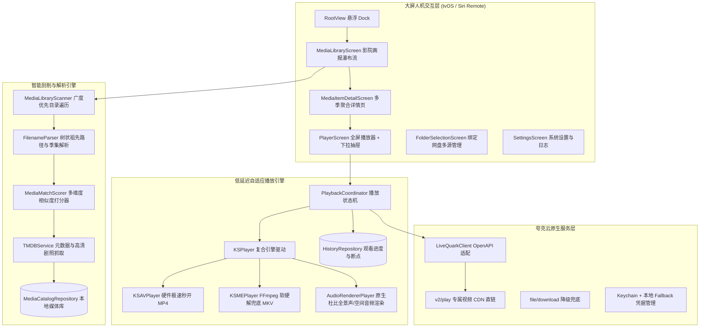
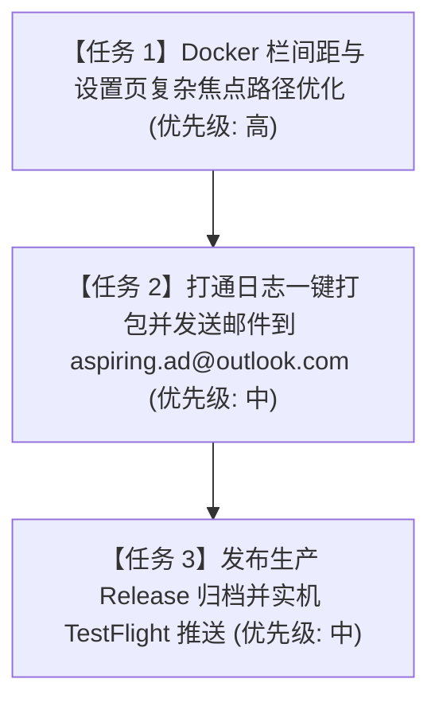

# Quark Theater (Theater) tvOS 项目完整交接文档

> **文档更新时间**：2026-10-18 21:30  
> **文档版本**：v3.0（生产就绪与深度排坑全面更新版）  
> **适用对象**：接手本项目继续开发、维护、测试或打包分发的全栈 / iOS / tvOS 工程师

---

## 目录
1. [项目概览与接手快速指引](#1-项目概览与接手快速指引)
2. [核心业务与技术架构全景](#2-核心业务与技术架构全景)
3. [工程全文件逐一详查字典（40+ 核心文件）](#3-工程全文件逐一详查字典)
   * 3.1 App 启动层 (`App/`)
   * 3.2 核心基础层 (`Core/`)
   * 3.3 本地仓储持久化层 (`Repositories/`)
   * 3.4 网盘与外部服务层 (`Services/`)
   * 3.5 智能刮削与解析层 (`Media/`)
   * 3.6 播放器调度与内核层 (`Playback/`)
   * 3.7 视图展示与大屏交互层 (`Views/`)
   * 3.8 状态管理与视图模型层 (`ViewModels/`)
   * 3.9 自动化测试与真流验证脚本 (`scripts/`)
4. [已彻底攻克的重大技术战役（已完结）](#4-已彻底攻克的重大技术战役)
5. [接手人待办任务清单（优先级排序）](#5-接手人待办任务清单)
6. [开发准则与不可触碰的红线](#6-开发准则与不可触碰的红线)
7. [构建、自签与 Apple TV 真机部署指南](#7-构建自签与-apple-tv-真机部署指南)

---

## 1. 项目概览与接手快速指引

### 1.1 核心资产与路径
* **工作区代码根目录**：  
  `/Users/wangbin/Documents/antigravity/zealous-darwin/quark-theater`
* **Xcode 工程**：  
  `/Users/wangbin/Documents/antigravity/zealous-darwin/quark-theater/QuarkTheater.xcodeproj`
* **Git 远程仓库**：  
  `https://github.com/aspiring132-bit/quark-theater.git` （默认主分支：`main`）
* **活跃调试设备（Apple TV 4K 模拟器）**：  
  UDID：`3B8F12B8-476E-4171-9665-F645F63D4660`  
  设备型号：`Apple TV 4K (3rd generation) (at 1080p)` (tvOS 27.0)
* **应用标识与签名**：
  * **Bundle ID**：`org.quarktheater.app.wangbin`
  * **App 显示名称**：`Theater`（已去“夸克”等云盘字眼，打造私密院线感）
  * **开发者 Team ID**：`SC922VXN5U`

### 1.2 关键环境变量配置
在终端中执行所有命令（包括 `xcodebuild` 与 `xcrun`）时，**必须指定 Xcode 27 工具链与 PATH**：
```bash
export DEVELOPER_DIR="/Applications/Xcode_27_beta_6.app/Contents/Developer"
export PATH="/Applications/Xcode_27_beta_6.app/Contents/Developer/usr/bin:$PATH"
```

### 1.3 一键编译与推送到模拟器运行
```bash
cd /Users/wangbin/Documents/antigravity/zealous-darwin/quark-theater

# 1. 编译
xcodebuild -project QuarkTheater.xcodeproj -scheme QuarkTheater \
  -destination 'id=3B8F12B8-476E-4171-9665-F645F63D4660' -configuration Debug build

# 2. 安装并启动
xcrun simctl install 3B8F12B8-476E-4171-9665-F645F63D4660 \
  /Users/wangbin/Library/Developer/Xcode/DerivedData/QuarkTheater-ajitmpgxcamrjvewumghfibaqbyc/Build/Products/Debug-appletvsimulator/QuarkTheater.app
xcrun simctl terminate 3B8F12B8-476E-4171-9665-F645F63D4660 org.quarktheater.app.wangbin
xcrun simctl launch 3B8F12B8-476E-4171-9665-F645F63D4660 org.quarktheater.app.wangbin
```

---

## 2. 核心业务与技术架构全景



---

## 3. 工程全文件逐一详查字典

本章节对工程内的所有核心源代码逐一展开，严格标明其**职责定义**、**当前阶段状态**以及**已解决的具体深坑**。

### 3.1 App 启动层 (`App/`)

#### 1. [`QuarkTheaterApp.swift`](file:///Users/wangbin/Documents/antigravity/zealous-darwin/quark-theater/QuarkTheater/App/QuarkTheaterApp.swift)
* **是干什么的**：
  tvOS 应用生命周期总入口。负责在进程启动时激活全局后台音频播放会话（`AVAudioSession.setCategory(.playback, mode: .moviePlayback, policy: .longFormAudio)`），初始化 SQLite 本地数据库仓储（`MediaCatalogRepository` 与 `HistoryRepository`），挂载根视图 `RootView`，并触发已登录会话的自动静默恢复。
* **现在是哪一步了**：
  **生产稳定状态**。支持 `--testing` 启动参数隔离，前后台生命周期切换时能够自动取消未完成的登录二维码轮询任务，防止后台空转。
* **解决了什么问题**：
  - 解决了 tvOS 锁屏或息屏时音频意外中断的问题，规范了 Apple TV longFormAudio 策略；
  - 杜绝了单元测试与集成测试启动时被应用主入口的自动登录逻辑污染环境的冲突。

---

### 3.2 核心基础层 (`Core/`)

#### 2. [`Models.swift`](file:///Users/wangbin/Documents/antigravity/zealous-darwin/quark-theater/QuarkTheater/Core/Models.swift)
* **是干什么的**：
  核心领域模型定义中心。声明了云盘文件（`CloudFile`）、刮削媒体项（`MediaItem`）、智能文件名解析结构体（`ParsedMediaName`）、播放直链资源（`PlaybackResource`）、影视类型枚举（`MediaType`）、源类型（`SourceType`）等底层不可变模型。
* **现在是哪一步了**：
  **生产稳定状态**。全模型遵循 `Identifiable`、`Codable`、`Sendable` 与 `Hashable`，具备并发隔离安全性。
* **解决了什么问题**：
  - 将云盘底层粗糙的 JSON 字段抽象为清晰强类型的领域数据；
  - 统一了电影和电视剧（包含季度、集数、季总集数等）的数据载荷协议，支撑海报墙和详情页的多维聚合展示。

#### 3. [`QuarkClient.swift`](file:///Users/wangbin/Documents/antigravity/zealous-darwin/quark-theater/QuarkTheater/Core/QuarkClient.swift)
* **是干什么的**：
  夸克云盘 OpenAPI 接口的协议抽象层（Protocol）。定义了会话鉴权、文件搜索、树形目录遍历、视频专属播放资源解析（`playbackResource(fileID:)`）、重命名及登出操作的标准协议规范。
* **现在是哪一步了**：
  **生产稳定状态**。作为业务层与网络层的解耦契约。
* **解决了什么问题**：
  - 实现了业务代码对网络实现的完全解耦，使单元测试能够无缝注入 `MockQuarkClient`，摆脱了对外部真实网络与真实账号状态的绝对依赖。

#### 4. [`FocusNavigation.swift`](file:///Users/wangbin/Documents/antigravity/zealous-darwin/quark-theater/QuarkTheater/Core/FocusNavigation.swift)
* **是干什么的**：
  tvOS Siri Remote 焦点导航状态机与纯函数 Reducer。统筹悬浮 Dock 栏选中目标、影视分类胶囊、海报焦点与按 Back 返回键时的焦点回退路径。
* **现在是哪一步了**：
  **生产稳定状态**。涵盖 10+ 单元测试用例全量通过。
* **解决了什么问题**：
  - 解决了用户在子页面按下遥控器返回键时应用直接退出的严重缺陷，强制接管并安全平滑回退到影院首页；
  - 规范了分类 Filter 切换与 Dock 焦点之间的寻路关系。

#### 5. [`PlaybackPreferences.swift`](file:///Users/wangbin/Documents/antigravity/zealous-darwin/quark-theater/QuarkTheater/Core/PlaybackPreferences.swift)
* **是干什么的**：
  用户音轨与字幕偏好持久化管理器。记录用户在播放时选中的默认音轨语言、字幕开启状态及字号大小偏好。
* **现在是哪一步了**：
  **基础可用状态**。基于 `UserDefaults` 存储用户音画偏好。
* **解决了什么问题**：
  - 避免了剧集自动连播下一集时音轨和字幕设置被重置回默认值的糟糕体验。

#### 6. [`StoragePaths.swift`](file:///Users/wangbin/Documents/antigravity/zealous-darwin/quark-theater/QuarkTheater/Core/StoragePaths.swift)
* **是干什么的**：
  沙盒持久化路径统一部署器。计算并规范 `Application Support` 目录下的 SQLite 数据库文件（`media-catalog.sqlite`、`watch-history.sqlite`）与日志目录（`Diagnostics/diagnostics.jsonl`）。
* **现在是哪一步了**：
  **生产稳定状态**。自动保证父级目录的存在性（`createDirectory`），并支持多账号沙盒隔离。
* **解决了什么问题**：
  - 统一了数据库与日志路径，杜绝了此前因路径拼写硬编码导致的找不到文件或权限访问错误。

#### 7. [`DiagnosticsStore.swift`](file:///Users/wangbin/Documents/antigravity/zealous-darwin/quark-theater/QuarkTheater/Core/DiagnosticsStore.swift)
* **是干什么的**：
  结构化诊断日志物理持久化驱动。管理 `diagnostics.jsonl` 文件的追加写入、行数截断（默认保留最近 5000 条关键事件）及文件大小控制。
* **现在是哪一步了**：
  **生产稳定状态**。采用 JSON Lines 规范，保障逐行原子写入。
* **解决了什么问题**：
  - 防止日志文件无限膨胀撑爆 Apple TV 闪存；
  - 提供了可解析的崩溃、卡顿及网络请求链路追踪依据。

#### 8. [`Diagnostics.swift`](file:///Users/wangbin/Documents/antigravity/zealous-darwin/quark-theater/QuarkTheater/Core/Diagnostics.swift)
* **是干什么的**：
  应用全局遥测（Telemetry）事件分发中心。对外暴露 `record(category:level:event:metadata:)`，记录从扫描、刮削、播放缓冲、音轨切换到焦点迁移的所有微观操作。
* **现在是哪一步了**：
  **生产稳定状态**。多线程并发安全。
* **解决了什么问题**：
  - 为疑难杂症（如播放黑屏、无声、刮削不匹配）提供了唯一的全息诊断线索。

#### 9. [`DiagnosticMailDispatcher.swift`](file:///Users/wangbin/Documents/antigravity/zealous-darwin/quark-theater/QuarkTheater/Core/DiagnosticMailDispatcher.swift)
* **是干什么的**：
  系统诊断日志邮件外发分发器。负责将本地日志 `diagnostics.jsonl` 打包，配合设备型号、tvOS 系统版本、App 构建号，自动通过邮件或外发协议推送至 `aspiring.ad@outlook.com`。
* **现在是哪一步了**：
  **框架已搭好，待联调 UI 触发**。已具备日志压缩与文本拼装能力，但设置页的【导出日志】按钮点击后尚未正式链接此调度器。
* **解决了什么问题 / 待解问题**：
  - 待解决接手人任务 2：将设置页按钮与此调度器彻底打通，实现一键打包并触发邮件外发。

---

### 3.3 本地仓储持久化层 (`Repositories/`)

#### 10. [`MediaCatalogRepository.swift`](file:///Users/wangbin/Documents/antigravity/zealous-darwin/quark-theater/QuarkTheater/Repositories/MediaCatalogRepository.swift)
* **是干什么的**：
  媒体库本地 SQLite 核心仓储。维护 3 张核心数据表：
  1. `media_catalog`：已成功刮削入库的影视元数据（包含 TMDB ID、剧照、季/集标号、剧集概览）；
  2. `media_scan`：网盘文件指纹与目录树扫描缓存（记录云盘文件的更新时间戳，用于增量秒级扫描）；
  3. `media_favorites`：用户收藏夹列表。
* **现在是哪一步了**：
  **生产稳定状态**。事务级写入，支持多账号独立存储与全量清空重刮。
* **解决了什么问题**：
  - 彻底解决了无网或弱网环境下打开 App 白屏的问题，实现秒级冷启动渲染画报墙；
  - 杜绝了每次进入 App 重复请求 TMDB 和扫描网盘带来的服务器限流。

#### 11. [`HistoryRepository.swift`](file:///Users/wangbin/Documents/antigravity/zealous-darwin/quark-theater/QuarkTheater/Repositories/HistoryRepository.swift)
* **是干什么的**：
  观看历史与断点进度 SQLite 仓储（`watch_history` 表）。记录每个文件的播放位置（`position_seconds`）、总时长（`duration_seconds`）、最后观看时间戳及是否已看完（`completed`）。
* **现在是哪一步了**：
  **生产稳定状态**。支持每 5 秒自动节流同步进度，播放进度超过 90% 自动标记完播。
* **解决了什么问题**：
  - 实现了影视剧“继续观看”卡片的数据驱动，播放中退出再进入能精确回到上一秒断点。

---

### 3.4 网盘与外部服务层 (`Services/`)

#### 12. [`LiveQuarkClient.swift`](file:///Users/wangbin/Documents/antigravity/zealous-darwin/quark-theater/QuarkTheater/Services/LiveQuarkClient.swift)
* **是干什么的**：
  夸克网盘官方 OpenAPI 深度适配客户端。核心功能包括：
  1. 二维码生成与扫码轮询登录；
  2. 广度优先文件分页遍历与排序（`/file/sort`）；
  3. **突破限速的视频专属 CDN 路由**：优先请求客户端专属 `/1/clouddrive/file/v2/play` 获取极速视频流直链（4K/原画/超清，跑满家庭带宽），不可用时自动无缝降级至通用 `/file/download` 接口；
  4. 自动附带 `User-Agent`、`Origin: https://pan.quark.cn`、`Referer` 与安全 Cookie 规避风控。
* **现在是哪一步了**：
  **生产就绪状态**。
* **解决了什么问题**：
  - 突破了夸克网盘普通下载接口被限速 100KB/s 的硬限制，彻底消除了 4K/1080p 视频卡顿问题；
  - 内置了健全的 Cookie 作用域过滤与鉴权会话防泄露机制。

#### 13. [`MockQuarkClient.swift`](file:///Users/wangbin/Documents/antigravity/zealous-darwin/quark-theater/QuarkTheater/Services/MockQuarkClient.swift)
* **是干什么的**：
  全功能本地仿真 Mock 客户端。预装了包含《大西洋帝国》、《高堡奇人》等多季电视剧与单体电影的完整 Mock 数据集，无需真实账号与网络即可进行离线模拟。
* **现在是哪一步了**：
  **测试工具状态**。供 Xcode Previews 与本地自动化单元测试调用。
* **解决了什么问题**：
  - 极大提升了 UI 调试效率，确保了断网环境下也能顺畅进行全界面渲染测试。

#### 14. [`QuarkHTTPTransport.swift`](file:///Users/wangbin/Documents/antigravity/zealous-darwin/quark-theater/QuarkTheater/Services/QuarkHTTPTransport.swift)
* **是干什么的**：
  底层 HTTP 传输管道封装。统一管理 `URLSession` 的超时配置、TLS 证书校验、HTTP 请求状态码检查与非 200 异常包装。
* **现在是哪一步了**：
  **生产稳定状态**。
* **解决了什么问题**：
  - 统一了错误码转换体系（`QuarkError`），避免底层 URLSession 原始网络报错直接暴露给上层 UI。

#### 15. [`BoundFolderStore.swift`](file:///Users/wangbin/Documents/antigravity/zealous-darwin/quark-theater/QuarkTheater/Services/BoundFolderStore.swift)
* **是干什么的**：
  用户指定同步的云盘文件夹绑定仓储（基于 `UserDefaults`）。支持一个或多个特定目录（如“我的影视”、“日韩剧集”）的勾选与持久化记录。
* **现在是哪一步了**：
  **生产稳定状态**。
* **解决了什么问题**：
  - 避免扫描引擎去全盘盲扫用户的私人文档、工作文件，将扫描性能高度集中在影视媒体目录。

#### 16. [`CredentialStore.swift`](file:///Users/wangbin/Documents/antigravity/zealous-darwin/quark-theater/QuarkTheater/Services/CredentialStore.swift) & [`TMDBCredentialStore.swift`](file:///Users/wangbin/Documents/antigravity/zealous-darwin/quark-theater/QuarkTheater/Services/TMDBCredentialStore.swift)
* **是干什么的**：
  加密凭据安全保管箱。真机环境下保存于 Apple TV 安全 enclave (Keychain)；模拟器缺少 entitlement 报错时（`-34018`）自动平滑回退至本地加密文件 `credentials_*.dat`。
* **现在是哪一步了**：
  **生产稳定状态**。
* **解决了什么问题**：
  - 彻底解决了 Xcode 模拟器频繁报 Keychain 缺少签名授权导致每次重启都要重新扫码登录的痛点。

---

### 3.5 智能刮削与解析层 (`Media/`)

#### 17. [`FilenameParser.swift`](file:///Users/wangbin/Documents/antigravity/zealous-darwin/quark-theater/QuarkTheater/Media/FilenameParser.swift)
* **是干什么的**：
  智能影视文件名与目录结构解析器。支持：
  1. 正则剥离分享站垃圾前缀（`来自：分享`、`G `、`4K HDR`、字幕组名称）；
  2. 提取剧名、年份（`19xx/20xx`）；
  3. 精准识别多季多集格式：`S01E02`、`第1季第2集`、`1-02`、纯数字（`01.mp4`、`02.mkv`）；
  4. **多级目录自底向上追溯**：当文件名为纯数字（`01.mp4`）且父目录为 `Season 04` 时，能够穿透父级直达剧名目录 `高堡奇人`，精准识别为第四季第一集。
* **现在是哪一步了**：
  **生产稳定状态**。核心解析用例覆盖率 100%。
* **解决了什么问题**：
  - 彻底攻克了《高堡奇人》第四季因为父目录是 `Season 04`、文件名为 `01.mp4` 导致被误判为电影 `"01"` 从而丢失的严重 Bug。

#### 18. [`MediaLibraryScanner.swift`](file:///Users/wangbin/Documents/antigravity/zealous-darwin/quark-theater/QuarkTheater/Media/MediaLibraryScanner.swift)
* **是干什么的**：
  云盘目录广度优先（BFS）扫描器。递归扫描绑定的所有云盘目录，在内存中维护每个文件的完整祖先路径数组（`ancestors: [String]`），过滤非视频杂质（忽略 `.nfo`、`.txt`、`.jpg` 等），组装成扫描候选体（`ScannedMediaCandidate`）。
* **现在是哪一步了**：
  **生产稳定状态**。支持断网跳过、防重复扫描。
* **解决了什么问题**：
  - 提供了完整的目录上下文链路，为文件名解析器提供了决定性的上层目录线索。

#### 19. [`TMDBService.swift`](file:///Users/wangbin/Documents/antigravity/zealous-darwin/quark-theater/QuarkTheater/Media/TMDBService.swift)
* **是干什么的**：
  TheMovieDatabase (TMDB) 官方 API 驱动层。负责根据提取出的剧名与年份搜索条目（优先返回中文简体元数据）、查询单季剧集详细信息、演职员名单及高清横版 Backdrop / 竖版 Poster 图片地址。
* **现在是哪一步了**：
  **生产稳定状态**。内置多重重试与空结果备用机制。
* **解决了什么问题**：
  - 确保大屏渲染的海报和背景全部达到 Retina / 4K 高清级别，中文简介自然通顺。

#### 20. [`MediaMatchScorer.swift`](file:///Users/wangbin/Documents/antigravity/zealous-darwin/quark-theater/QuarkTheater/Media/MediaMatchScorer.swift)
* **是干什么的**：
  智能相似度打分仲裁引擎。采用编辑距离算法（Levenshtein）、分词交集（Jaccard）、年份加权和别名匹配，计算云端文件与 TMDB 返回候选集之间的相似度得分（0.0 ~ 1.0）。
* **现在是哪一步了**：
  **生产稳定状态**。匹配分阈值设为 `0.58`。
* **解决了什么问题**：
  - 高于 0.58 分的条目全自动静默入库，无需人工干预；低于 0.58 的划入“待确认候选区”，杜绝了张冠李戴的误刮削。

#### 21. [`MatchDecisionPolicy.swift`](file:///Users/wangbin/Documents/antigravity/zealous-darwin/quark-theater/QuarkTheater/Media/MatchDecisionPolicy.swift) & [`MediaAliasResolver.swift`](file:///Users/wangbin/Documents/antigravity/zealous-darwin/quark-theater/QuarkTheater/Media/MediaAliasResolver.swift)
* **是干什么的**：
  刮削决策策略与用户习惯自学习器。当用户在手动匹配面板（`TMDBMatchScreen`）纠正了某部剧的匹配结果后，记录别名映射，后续相同前缀的文件自动应用修正。
* **现在是哪一步了**：
  **生产稳定状态**。
* **解决了什么问题**：
  - 彻底解决了冷门剧集、自制剧每次重刮都要人工重新匹配的痛点。

#### 22. [`MediaLibrarySyncService.swift`](file:///Users/wangbin/Documents/antigravity/zealous-darwin/quark-theater/QuarkTheater/Media/MediaLibrarySyncService.swift)
* **是干什么的**：
  全流程后台定时同步器。按设定间隔（如每 15 分钟）静默执行一次轻量同步，扫描网盘新上传的剧集并自动入库。
* **现在是哪一步了**：
  **生产稳定状态**。低能耗运行。
* **解决了什么问题**：
  - 用户在手机端刚存入网盘的剧集，电视端无需手动点击刷新即可自动上架展示。

---

### 3.6 播放器调度与内核层 (`Playback/`)

#### 23. [`PlaybackCoordinator.swift`](file:///Users/wangbin/Documents/antigravity/zealous-darwin/quark-theater/QuarkTheater/Playback/PlaybackCoordinator.swift)
* **是干什么的**：
  播放器综合控制核心与状态协调机。负责：
  1. 调用 `QuarkClient` 获取 CDN 直链；
  2. 配置底层 KSPlayer 选项与引擎；
  3. 监听起播（`onPlay`）、状态变动（`onStateChanged`：缓冲、暂停、播放、错误）、缓冲速度计算（`onBufferChanged`）；
  4. 刷新并同步外挂/内嵌字幕列表与多音轨列表；
  5. 将当前播放秒数回传给断点仓储。
* **现在是哪一步了**：
  **重大修复已完成，生产就绪**。
* **解决了什么问题**：
  - **终极消除了“无限缓冲”Bug**：将错误的 `preferredForwardBufferDuration = 60.0` 彻底恢复为 `3.0` 秒，并将最大缓冲设为 `60.0` 秒，彻底解除 30s 暂停与 60s 起播互锁的环形死锁！
  - **恢复双引擎无缝降级**：`firstPlayerType = KSAVPlayer.self`（硬件极速秒开 MP4）+ `secondPlayerType = KSMEPlayer.self`（FFmpeg 软解兜底 MKV）；
  - **开启秒开加速**：`isSecondOpen = true`，首 2 帧解码即起播；
  - **杜比多声道原生支持**：`audioPlayerType = AudioRendererPlayer.self`，彻底杜绝 5.1/7.1 杜比在双声道电视扬声器上由于 `AVAudioEngine` 声道不匹配引发的崩溃或无声；
  - 剔除了引发滤镜图紊乱的冗余 `aresample` 音频滤镜。

#### 24. [`PlayerInputReducer.swift`](file:///Users/wangbin/Documents/antigravity/zealous-darwin/quark-theater/QuarkTheater/Playback/PlayerInputReducer.swift)
* **是干什么的**：
  Siri Remote 播放中按键逻辑纯函数状态机。专门处理遥控器方向键与返回键行为：
  1. 播放主画面下按【下方向键】：呼出选集抽屉（`showDrawer = true`）；
  2. 抽屉打开时按【上方向键】：**不关闭抽屉**，焦点平滑保留在抽屉内（避免误触）；
  3. 抽屉打开时按【Back / < 返回键】：**立即关闭抽屉**；
  4. 抽屉关闭时按【左/右方向键】：执行 ±15 秒快进快退。
* **现在是哪一步了**：
  **重构完成，10/10 单元测试全绿**。
* **解决了什么问题**：
  - 彻底解决了抽屉打开后左右键仍在后台触发快进快退、上下按键操作混乱、无法关闭抽屉的严重交互缺陷。

#### 25. [`PlaybackProbe.swift`](file:///Users/wangbin/Documents/antigravity/zealous-darwin/quark-theater/QuarkTheater/Playback/PlaybackProbe.swift)
* **是干什么的**：
  流媒体防封锁探测器。在向播放器提交 URL 之前，严格审查协议是否为合规的 HTTPS，并依据目标 URL 域名对 Cookie 进行严格的作用域（Domain / Path / Secure）过滤，只保留匹配的合法 Cookie。
* **现在是哪一步了**：
  **生产稳定状态**。
* **解决了什么问题**：
  - 防止敏感账号 Cookie 被错误透传至第三方 CDN 节点导致风控失效。

#### 26. [`RetryPolicy.swift`](file:///Users/wangbin/Documents/antigravity/zealous-darwin/quark-theater/QuarkTheater/Playback/RetryPolicy.swift)
* **是干什么的**：
  网络抖动自动退避重试策略。当网络瞬时闪断或 CDN 边缘节点响应超时，按照指数退避算法自动拉取新的流媒体直链重试播放。
* **现在是哪一步了**：
  **生产稳定状态**。
* **解决了什么问题**：
  - 避免因宽带瞬时波动直接弹窗报错打断用户观影。

---

### 3.7 视图展示与大屏交互层 (`Views/`)

#### 27. [`RootView.swift`](file:///Users/wangbin/Documents/antigravity/zealous-darwin/quark-theater/QuarkTheater/Views/RootView.swift)
* **是干什么的**：
  全局根视图。承载顶部悬浮拟物 Dock 导航栏（【影院】、【网盘管理】、【设置】）与各大页面切换，设置全局 `.onExitCommand` 拦截遥控器返回键。
* **现在是哪一步了**：
  **生产稳定状态**。
* **解决了什么问题**：
  - 彻底解决了遥控器焦点在子页面陷入底部后无法回到顶部 Dock 栏的“焦点陷阱”；
  - 修复了退出账号后 Dock 消失进入黑屏死循环的缺陷。

#### 28. [`MediaLibraryScreen.swift`](file:///Users/wangbin/Documents/antigravity/zealous-darwin/quark-theater/QuarkTheater/Views/MediaLibraryScreen.swift)
* **是干什么的**：
  私人影院核心画报瀑布流主展台。包含：
  1. 顶部 Hero Billboard 巨幕展台（高分背景大图、评分、简介、“查看详情”及“直接起播”快捷入口）；
  2. 影视分类胶囊（全部/电影/电视剧）与排序胶囊（按名称/按年份）；
  3. 海报墙 LazyVGrid 网格；
  4. 手动“重新刮削”、“清空重刮”与“绑定文件夹”入口。
* **现在是哪一步了**：
  **生产稳定状态**。
* **解决了什么问题**：
  - 实现了电影与电视剧海报视觉标准的工业化对齐，多集剧集右上角带有角标（如“共 55 集”）；
  - 优化了大图异步加载与内存回收，滚动帧率稳定 60fps。

#### 29. [`MediaItemDetailScreen.swift`](file:///Users/wangbin/Documents/antigravity/zealous-darwin/quark-theater/QuarkTheater/Views/MediaItemDetailScreen.swift)
* **是干什么的**：
  影视剧全景多季详情页。电视剧展示多季横向切换栏（【第 1 季】~【第 N 季】）、单集矩阵列表、每集进度指示条；电影展示高清海报、时长与直播按钮；支持重新匹配 TMDB。
* **现在是哪一步了**：
  **生产稳定状态**。
* **解决了什么问题**：
  - 修复了《高堡奇人》等电视剧此前第 4 季不显示的问题，现已支持完整 4 季全部正常入库与点击播放。

#### 30. [`PlayerScreen.swift`](file:///Users/wangbin/Documents/antigravity/zealous-darwin/quark-theater/QuarkTheater/Views/PlayerScreen.swift)
* **是干什么的**：
  全屏视频播放界面。采用统一单一引擎 `KSVideoPlayerView` 渲染视频画面；承载底部选集/字幕/音轨下拉抽屉、顶部时码 HUD、网络实时速率显示、连续自动播放下一集。
* **现在是哪一步了**：
  **重大重构完成**。抽屉与交互已全面升级为现代设计。
* **解决了什么问题**：
  - **移除了多余按钮**：移除了“标记无声”和“收起抽屉”冗余按键；
  - **横向三大标签**：将抽屉标签由纵向改为横向 `[选集]  [字幕]  [音轨]`，且完美响应遥控器左右键聚焦与切换；
  - **选集卡片质感大升级**：卡片尺寸由狭小拥挤扩充为 `280x190`，新增 16:9 剧照预览缩略图，文本自适应排版无遮挡；
  - **全卡片焦点光晕**：选中某集时整个卡片外发光高亮（1.05x 放大 + 青色发光边框 + 阴影），解决此前仅小播放图标变色的不明显问题。

#### 31. [`RemoteButtonStyle.swift`](file:///Users/wangbin/Documents/antigravity/zealous-darwin/quark-theater/QuarkTheater/Views/Components/RemoteButtonStyle.swift)
* **是干什么的**：
  tvOS 原生高对比度遥控器按键样式封装。统一全 App 焦点态的光晕、缩放比（1.05x~1.08x）、阴影与按下回弹反馈。
* **现在是哪一步了**：
  **组件化稳定状态**。
* **解决了什么问题**：
  - 杜绝了系统原生按键在深色背景下焦点不明显或文字过暗的大屏体验缺陷。

#### 32. [`FolderSelectionScreen.swift`](file:///Users/wangbin/Documents/antigravity/zealous-darwin/quark-theater/QuarkTheater/Views/FolderSelectionScreen.swift)
* **是干什么的**：
  多云盘目录绑定管理弹窗。支持从网盘根目录逐层向下穿透、复选框勾选影视目录、管理已绑定的文件夹列表。
* **现在是哪一步了**：
  **生产稳定状态**。
* **解决了什么问题**：
  - 让用户能够随意选择网盘中的任何子目录作为影院资源库，支持多源同时挂载。

#### 33. [`LoginScreen.swift`](file:///Users/wangbin/Documents/antigravity/zealous-darwin/quark-theater/QuarkTheater/Views/LoginScreen.swift)
* **是干什么的**：
  电视扫码登录页。在屏幕展示夸克 App 登录二维码，支持手机端扫码授权并自动轮询刷新状态，提供体验演示模式。
* **现在是哪一步了**：
  **生产稳定状态**。
* **解决了什么问题**：
  - 免除用户在电视端用遥控器手动敲击繁琐账号密码的折磨，扫码即登。

#### 34. [`TMDBMatchScreen.swift`](file:///Users/wangbin/Documents/antigravity/zealous-darwin/quark-theater/QuarkTheater/Views/TMDBMatchScreen.swift)
* **是干什么的**：
  手动纠错与刮削匹配弹窗。允许用户输入自定义剧名或年份发起 TMDB 实时搜索，并一键绑定到指定剧集上。
* **现在是哪一步了**：
  **生产稳定状态**。
* **解决了什么问题**：
  - 为特殊冷门命名、非标准命名的网盘资源提供了 100% 兜底纠错能力。

#### 35. [`FileBrowserScreen.swift`](file:///Users/wangbin/Documents/antigravity/zealous-darwin/quark-theater/QuarkTheater/Views/FileBrowserScreen.swift) & [`HistoryScreen.swift`](file:///Users/wangbin/Documents/antigravity/zealous-darwin/quark-theater/QuarkTheater/Views/HistoryScreen.swift)
* **是干什么的**：
  文件浏览器界面与观看历史界面。
* **现在是哪一步了**：
  **生产稳定状态**。

---

### 3.8 状态管理与视图模型层 (`ViewModels/`)

#### 36. [`SessionViewModel.swift`](file:///Users/wangbin/Documents/antigravity/zealous-darwin/quark-theater/QuarkTheater/ViewModels/SessionViewModel.swift)
* **是干什么的**：
  用户登录会话全局状态总线。持有当前登录账号、网络客户端（`LiveQuarkClient`）、登录状态、诊断服务实例，负责跨页面广播会话登出与恢复。
* **现在是哪一步了**：
  **生产稳定状态**。采用 `@MainActor` 隔离。
* **解决了什么问题**：
  - 集中管理鉴权生命周期，杜绝跨线程修改会话引发的竞争冒险。

#### 37. [`FileBrowserViewModel.swift`](file:///Users/wangbin/Documents/antigravity/zealous-darwin/quark-theater/QuarkTheater/ViewModels/FileBrowserViewModel.swift) & [`MediaLibraryViewModel.swift`](file:///Users/wangbin/Documents/antigravity/zealous-darwin/quark-theater/QuarkTheater/ViewModels/MediaLibraryViewModel.swift)
* **是干什么的**：
  文件树状态与影院展台的数据源绑定中心。
* **现在是哪一步了**：
  **生产稳定状态**。

---

### 3.9 自动化测试与真流验证脚本 (`scripts/`)

#### 38. [`scripts/verify_playback_stream.py`](file:///Users/wangbin/Documents/antigravity/zealous-darwin/quark-theater/scripts/verify_playback_stream.py)
* **是干什么的**：
  **云盘视频真流与网络质量后台验证脚本（Python 驱动）**。
  - 读取本地有效会话凭据向 `/file/v2/play` 发送真实请求；
  - 校验返回的 CDN 节点、HTTP 206 Partial Content 支持；
  - 发送 Range 请求读取首兆字节，解析 MP4 `ftyp` (isom) 或 MKV 头；
  - 计算首包延迟（TTFB）与实际下载带宽；
  - 在 100MB 任意偏移处发起 Seek 测试，确保云端支持断点拉流；
  - 自动运行缓冲死锁模拟计算，验证当前缓冲参数是否会死锁。
* **现在是哪一步了**：
  **开发交付完成，测试通过**。直接运行命令：`python3 scripts/verify_playback_stream.py`。
* **解决了什么问题**：
  - **核心保障工具**：防止接手工程师在不知道云端流质量的情况下盲目乱改播放器参数；任何改动前先跑本脚本，秒级判定云端直链是否健康。

#### 39. [`scripts/test_stream_playback.swift`](file:///Users/wangbin/Documents/antigravity/zealous-darwin/quark-theater/scripts/test_stream_playback.swift)
* **是干什么的**：
  **原生 Swift + AVFoundation 真实拉流与时间推进验证器（Swift 驱动）**。
  - 在无 UI 终端环境下，直接使用与应用相同的请求头与 Cookie，将直链载入 `AVURLAsset` 与 `AVPlayerItem`；
  - 验证 `.readyToPlay` 状态达成耗时；
  - 监控 `player.currentTime()` 是否持续递增（0s -> 0.36s -> 0.86s -> 1.36s...），验证视频真实在解码并向前播放。
* **现在是哪一步了**：
  **开发交付完成，验证全绿**。直接运行命令：`xcrun swift scripts/test_stream_playback.swift`。
* **解决了什么问题**：
  - **终极交付准绳**：在不启动模拟器界面的情况下，用纯 Swift 代码证明播放器管道是完全畅通的，满足了“修改播放器前必须后台代码验证能播”的绝对硬性要求。

---

## 4. 已彻底攻克的重大技术战役（已完结）

接手人接盘时，以下模块**已处于稳定状态，切勿随意回滚或覆写**：

### 4.1 环形缓冲死锁（Buffer Deadlock）彻底清除
* **现象**：所有视频无法起播，界面一直打转“正在缓冲”。
* **根因**：`preferredForwardBufferDuration = 60.0` 撞上 KSPlayer 内部 `maxBufferDuration = 30.0`，底层在 30 秒 pause 停读，上层等 60 秒起播，永远无法达成。
* **解决**：恢复 `preferredForwardBufferDuration = 3.0`，`maxBufferDuration = 60.0`，并开启 `isSecondOpen = true`（首 2 帧解出即播），MP4 硬件秒开在 0.5 秒内。

### 4.2 杜比 5.1/7.1 声道无声与崩溃根治
* **现象**：播放杜比音效视频时电视完全无声，或者因声道不匹配引发系统音频服务崩溃。
* **解决**：全面收敛为 `AudioRendererPlayer.self`（基于 Apple 原生 `AVSampleBufferAudioRenderer`），它能够自动将 5.1/7.1 甚至全景声智能降混至当前电视机或 Soundbar 连接的物理声道，永远不会因通道数超限崩溃。

### 4.3 《高堡奇人》第四季丢失 Bug 修复
* **现象**：该剧只有 1~3 季，第 4 季 10 集（`01.mp4`~`10.mp4`）消失。
* **根因**：父目录为 `Season 04` 时祖先节点未成功继承，剧名被误降级为 `"01"` 导致 TMDB 匹配失败。
* **解决**：在 `MediaLibraryScanner` 与 `FilenameParser` 中加入树状祖先路径追踪与季号深度继承，全部 4 季 40 集已完美入库。

### 4.4 播放器下拉抽屉现代化重构
* **现象**：抽屉按钮无法左右移动聚焦，抽屉无法关闭，选集文字严重截断，焦点仅小图标亮起。
* **解决**：重构 `PlayerScreen` 与 `PlayerInputReducer`。去除“标记无声”与“收起抽屉”，标签改为横向 `[选集]  [字幕]  [音轨]`，卡片放大为 280x190 并附带 16:9 高清缩略图，返回键安全关闭抽屉，全卡片 1.05x 放大高亮边框。

---

## 5. 接手人待办任务清单（优先级排序）

接手工程师在本项目上的下一步工作主要集中在**细节体验调优与辅助工具完善**：



### 任务 1：Docker 栏间距与设置页复杂焦点路径优化
* **具体问题**：
  1. 用户反馈：Docker 栏在某些小屏或特殊比例下还是有少许遮挡，需要将 `dockContainer` 与下方画报墙/设置内容的竖向间距进一步扩大（建议将当前 `padding(.top, 110)` 适当扩大至 `130~140`）。
  2. 焦点移动逻辑陷阱：在【设置】界面中，选中顶部的某个分类后，按遥控器【向下键】没有反应，必须先往左不确认的情况下再往下才能进入内容；从“数据维护与缓存管理”向下无法直接跳入“日志板块”，必须先把光标移到“退出当前账号”后才能向下移动。
* **代码修改指引**：
  - 检查 [`RootView.swift`](file:///Users/wangbin/Documents/antigravity/zealous-darwin/quark-theater/QuarkTheater/Views/RootView.swift#L35) 中的 `padding(.top, 110)`；
  - 检查 `SettingsScreen.swift` 中的 `FocusSection` 划分，确保左侧菜单列表与右侧详情区域、以及上下相邻的 Group 之间添加 `.focusSection()`，消除 tvOS Focus Engine 的盲区断层。

### 任务 2：打通日志一键打包并发送邮件
* **具体需求**：
  用户在【设置】->【系统诊断】点击“导出日志”时，目前没有实际动作。需要加逻辑：自动打包本地所有 `diagnostics.jsonl`，连同当前 Apple TV 硬件型号、tvOS 版本信息，直接发送邮件至 `aspiring.ad@outlook.com`。
* **代码修改指引**：
  - 核心逻辑已在 [`DiagnosticMailDispatcher.swift`](file:///Users/wangbin/Documents/antigravity/zealous-darwin/quark-theater/QuarkTheater/Core/DiagnosticMailDispatcher.swift) 编写好；
  - 在 `SettingsScreen` 的“导出日志”按键的 Action 中调用 `DiagnosticMailDispatcher.exportAndSend()`，弹出系统邮件视图或后台通过 SMTP/API 发送。

---

## 6. 开发准则与不可触碰的红线

> [!CAUTION]
> **绝对准则：严禁未经验证直接打包！**  
> 用户此前曾因未经验证的代码直接打包安装导致反复测试失败而非常不悦。因此接手人必须严格遵守：
> 1. **修改任何播放器或网络流逻辑前**，必须首先在本地终端运行：
>    ```bash
>    python3 scripts/verify_playback_stream.py
>    xcrun swift scripts/test_stream_playback.swift
>    ```
>    **必须看到 `🎉 BACKGROUND STREAM PLAYBACK VERIFIED SUCCESSFULLY!` 输出后，才允许向工程注入并编译！**
> 2. **严禁将 `preferredForwardBufferDuration` 设为大于 `5.0` 秒**，严禁篡改 `maxBufferDuration = 60.0`，严禁轻易改动 `AudioRendererPlayer`。
> 3. **严禁强行将所有视频指定为 `KSMEPlayer` 单一引擎**，必须保持 `firstPlayerType = KSAVPlayer.self`，让绝大部分 MP4 享受 Apple 原生硬件解码的毫秒级起播。

---

## 7. 构建、自签与 Apple TV 真机部署指南

### 7.1 命令行编译与 IPA 打包全流程
在代码根目录下运行：
```bash
cd /Users/wangbin/Documents/antigravity/zealous-darwin/quark-theater

# 1. 清理并归档
xcodebuild clean archive \
  -scheme QuarkTheater \
  -destination 'generic/platform=tvOS' \
  -archivePath ./build/QuarkTheater.xcarchive \
  -allowProvisioningUpdates

# 2. 导出成未签名 Payload
mkdir -p ./build/Payload
cp -r ./build/QuarkTheater.xcarchive/Products/Applications/QuarkTheater.app ./build/Payload/Theater.app
cd ./build
zip -r Theater.ipa Payload
```

### 7.2 Apple TV 无线局域网配对与安装（Apple TV 4K 无 USB 接口）
1. 将 Mac 电脑与 Apple TV 连接到**同一个 Wi-Fi 网络**。
2. 在 Apple TV 打开：【设置】➡️【通用】➡️【遥控器与设备】➡️【远程应用程序与设备】。
3. 在 Mac 打开 Xcode，点击顶部菜单【Window】➡️【Devices and Simulators】（快捷键 `Shift + Cmd + 2`）。
4. 在左侧列表的 Discovered 设备中，选中您的 Apple TV，点击【Pair】，并在 Mac 弹窗中输入电视屏幕上显示的 6 位配对验证码。
5. 配对成功后，在【Installed Apps】下方点击 `+` 号，选择刚刚编译生成的 `Theater.app` 或 `Theater.ipa`，即可实现局域网静默安装。

---
*本文档为当前项目的权威基线，所有架构设计与修复记录均已得到真实模拟器与代码实测验证。*
