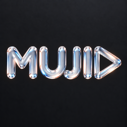
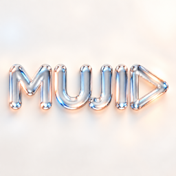

# MUJIO 跨平台品牌素材

本目录收纳可复用的 MUJIO 玻璃字标应用图标、启动/横幅展示图，以及当前 tvOS 分层图标素材。图标源图均为完整方形画布，未预先做圆角；iOS、Android 和 macOS 可按各自平台规范套用外形遮罩。

| 深色图标 | 浅色图标 |
| --- | --- |
|  |  |

## 图标

- `icons/source/MUJIO-dark-master.png` — 深色背景母图，1254 × 1254。
- `icons/source/MUJIO-light-master.png` — 浅色背景母图，1254 × 1254。
- `icons/MUJIO-{dark,light}-{1024,512,256,128,64}.png` — 常用方形导出尺寸。
- `android/MUJIO-PlayStore-{dark,light}-512.png` — Android 商店 512 × 512 图标。
- `android/launcher/` — mdpi、hdpi、xhdpi、xxhdpi、xxxhdpi 的 48、72、96、144、192 px launcher PNG，分别提供深色/浅色底。
- `ios/` — iOS 1024 × 1024 深色/浅色 App Store 源图。
- `macos/MUJIO-{dark,light}.icns` — macOS 图标容器；对应 `.iconset/` 子目录保留构建 `.icns` 用的 PNG 尺寸源图。

## 横向展示图与电视端图层

- `banners/MUJIO-launch-dark-1672x941.png` — 深色启动/品牌展示图。
- `banners/MUJIO-banner-light-1942x809.png` — 浅色横幅/品牌展示图。
- `banners/QuarkTheater-TopShelf-1920x720.png`、`QuarkTheater-TopShelf-Wide-2320x720.png` — tvOS Top Shelf 横幅源图。
- `tvos-layered/` — tvOS 桌面图标的 Back、Middle、Front 三层 PNG（400 × 240）。

深浅两种应用图标都使用同一玻璃字标。浅色版按浅色背景重新渲染，深色版沿用已定稿的深色概念图。各平台的圆角、圆形或其他外形应由平台在方形源图上处理，避免素材边缘被重复裁切。

## 跨平台配色方案

MUJIO 的视觉基准是**深炭黑、冰蓝、玻璃白与少量暖桃**。深炭黑 `#121417`、冰蓝 `#A9D7F4`、玻璃白 `#F3F6F8`、暖桃 `#F3B6A1` 取自现有 tvOS `BrandPalette`；下表的浅色模式操作色、容器色及状态色是为 Android、iOS 和 macOS 共用而提出的配色方案。绿色只用于成功或已连接等语义状态，不作为品牌主操作色。

| 用途 | 深夜模式 | 浅色模式 |
| --- | --- | --- |
| 页面背景 | `#0D1015` | `#F3F6F8` |
| 顶栏、导航底 | `#121417` | `#FFFFFF` |
| 卡片、菜单底 | `#20242A` | `#FFFFFF` |
| 弹窗、抬高的表面 | `#2A3138` | `#E8EEF3` |
| 主操作色 | 冰蓝 `#A9D7F4` | 深冰蓝 `#0A6683` |
| 主操作上的文字 | `#121417` | `#FFFFFF` |
| 主要文字 | `#F3F6F8` | `#121417` |
| 次要文字 | `#9DA5AC` | `#465867` |
| 可交互控件边框 | `#657582` | `#778C9A` |
| 已选中底色 | `#1C4255` | `#DDEFF8` |
| 已选中文字 | `#F3F6F8` | `#134E65` |
| 已选中描边 | `#A9D7F4` | `#0A6683` |
| 暖桃品牌副色 | `#F3B6A1` | `#A34E34` |
| 普通分隔线 | `#38434C` | `#D7E0E5` |

浅冰蓝 `#A9D7F4` 放在白底上的对比度约为 **1.53:1**，不能直接充当浅色模式里的按钮文字或细描边。浅色主操作色加深为 `#0A6683` 后，白字与它的对比度约为 **6.48:1**；深夜主按钮的炭黑字与冰蓝底约为 **12.05:1**。普通文字按至少 4.5:1、识别控件及其状态所必需的视觉标记按至少 3:1 设计。海报上的文字还要结合实际图片逐张检查。

### 焦点、选中和按钮

**焦点**表示遥控器、键盘或鼠标此刻指向的位置；**选中**表示已经确定的筛选项、集数或音轨。焦点移动后，选中标记仍须保留。两者同时出现时，外层焦点框和内部选中标记都要可见。

| 状态 | 深夜模式 | 浅色模式 | 行为 |
| --- | --- | --- | --- |
| 主按钮默认 | `#A9D7F4` 底，`#121417` 字 | `#0A6683` 底，白字 | 每个操作区只突出一个主操作 |
| 次按钮默认 | `#20242A` 底，白字，`#657582` 边 | `#E8EEF3` 底，深字，`#778C9A` 边 | 取消、筛选、更多等次要操作 |
| 获得焦点 | 外侧 2 px `#F3F6F8` 焦点框 | 外侧 2 px `#0A6683` 焦点框 | 焦点框与按钮间留 2 px；整颗按钮放大约 1.04 倍，不单独放大图标 |
| 已选中 | `#1C4255` 底，`#A9D7F4` 边，白字 | `#DDEFF8` 底，`#0A6683` 边，`#134E65` 字 | 再加勾选、播放图标或文字标记，焦点移走后仍显示 |
| 焦点且已选中 | 保留选中标记，再叠加焦点框 | 同左 | 不用单一颜色覆盖两种状态 |
| 按下瞬间 | 主按钮变 `#75BEDF` | 主按钮变 `#084F68` | 短暂缩至 0.98 倍；松开后恢复对应状态 |
| 禁用 | `#2A3138` 底，`#8C9AA5` 字 | `#DCE4E9` 底，`#6F7D87` 字 | 无焦点光晕，不表现得像已选中 |
| 加载 | 保持原按钮颜色和宽度 | 同左 | 在原位置显示转圈和状态文字，阻止重复提交 |

海报卡片、选集卡片获得焦点时，保留图片，给**整张卡片**加 2–3 px 高对比外框、轻微阴影和约 1.04 倍缩放。不要用白色填充盖住图片。已选中集数用冰蓝描边与文字标记；正在播放再加一个小的暖桃色播放标记。卡片标题压在深色渐变底上，并保留足够内边距。焦点缩放时，父级容器需预留空间，避免裁切和遮住相邻卡片。

### 播放器与语义色

全屏视频的控制层在两种主题下都使用深炭黑半透明底与玻璃白文字，以保证画面上的控件可读。全屏播放器使用下表的“深夜模式”列；浅色列用于详情页等浅色页面中的进度控件。三段进度条分别采用：

| 进度状态 | 深夜模式 | 浅色页面中的进度控件 |
| --- | --- | --- |
| 已播放 | `#A9D7F4` | `#0A6683` |
| 已缓冲 | `#93A5B3` | `#6B7F8D` |
| 未加载轨道 | `#35414B` | `#D3DDE4` |
| 预览跳转位置 | `#F3B6A1` | `#A34E34` |

绿色只表达成功或已连接，橙黄表达警告，红色表达错误。暖桃作为品牌副色，用于播放中徽标、少量重点提示或高光；不要代替警告/错误的语义色，也不要把所有按钮都涂成品牌强调色。海报与剧照保留自身颜色，界面框架保持中性。

### Android 接入建议

- Material 3 的 `primary/onPrimary` 对应主操作色与其文字；`primaryContainer/onPrimaryContainer` 对应已选中容器与其文字；`tertiary` 可承载少量暖桃品牌色；`surfaceContainer` 用于卡片和菜单。
- 手机端提供“跟随系统、深夜、浅色”三档，默认跟随系统。Android TV 以深夜模式为默认，并明确区分默认、焦点、按下和选中状态。
- 品牌主界面使用固定的 MUJIO 颜色角色。若提供随壁纸变化的动态配色，应作为可选偏好，避免主要按钮和选集状态随壁纸变成与品牌无关的颜色。

设计依据：[Material 3 颜色角色](https://m3.material.io/styles/color/the-color-system)、[Android Material 3 主题](https://developer.android.com/develop/ui/compose/designsystems/material3)、[Android TV 焦点](https://developer.android.com/design/ui/tv/guides/styles/focus-system)、[Android TV 色彩](https://developer.android.com/design/ui/tv/guides/styles/color-system)、[WCAG 文字对比](https://www.w3.org/WAI/WCAG22/Understanding/contrast-minimum)、[WCAG 非文字对比](https://www.w3.org/WAI/WCAG22/Understanding/non-text-contrast)。
