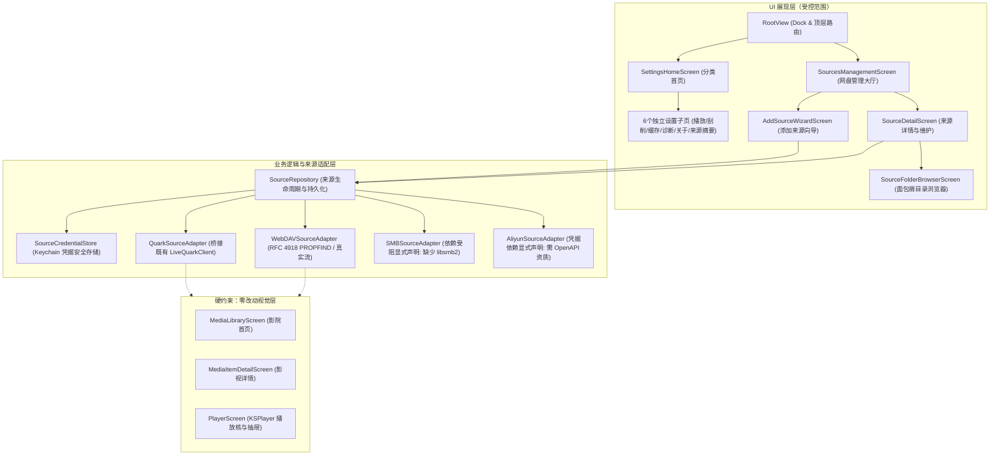
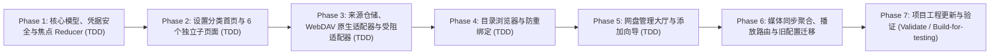

# 实施方案：多网盘管理与设置导航 (tvOS 27)

> **基线分支**：`codex/media-scraper-player` @ `3a68983`（已包含 Mujio 品牌、播放进度节流、选集抽屉焦点稳定、真机启动降级等全部 main 修复）
> **需求依据**：已评审通过的《业务需求说明书：多网盘管理与设置导航（版本 1.0 · 2026-10-24）》（`docs/BRD-Multi-Cloud-Management-and-Settings-v1.0-2026-10-24.docx`）
> **核心硬约束**：
> 1. **媒体库零视觉与交互回归**：绝对不改动 `MediaLibraryScreen`、`MediaItemDetailScreen`、`PlayerScreen` 及其抽屉的视觉与交互。
> 2. **真实能力与真实支持**：严禁伪造或猜测 SMB/云盘协议。tvOS 缺乏系统级用户态 SMB API 且当前工程未链接第三方 C 库（如 libsmb2），严禁使用 URLSession 伪造 SMB，需在 UI 明确展示依赖受阻说明与技术原因；阿里云盘需明确指示官方 OpenAPI 资质/凭据要求，严禁伪造 live API 端点；WebDAV 基于标准 RFC 4918 HTTP `PROPFIND` 原生完整实现。
> 3. **凭据安全与隐私**：所有密码、Token、Cookie 仅存入 Keychain，数据库与元数据仅存 `sourceID`；日志与诊断必须脱敏，严禁记录敏感 Token 或带鉴权签名的完整 URL。
> 4. **非破坏性操作**：解除/移除来源仅清除本地关联与 Keychain 凭据，**严禁向远端存储发送任何 DELETE 或 MOVE 请求**。
> 5. **未跟踪产物防损**：严格保护当前工作树下未跟踪的 `dist/*.ipa` 与 `dist/*.zip` 文件，严禁清理、覆盖、暂存或提交 `dist` 目录。

---

## 1. 架构总览与组件分工



---

## 2. 详细设计与关键契约

### 2.1 存储来源模型与抽象契约 (`StorageSource.swift`)

1. **`StorageSourceType` 扩展与能力说明**：
   - `.quark`：成熟支持（夸克扫码/Cookie/官方专线直链）。
   - `.webdav`：原生支持（RFC 4918 `PROPFIND`、Basic/Digest 认证、HTTPS 优先、Range 串流）。
   - `.smb`：tvOS 平台依赖受阻（tvOS 无内置用户态 SMB 支持，缺少 libsmb2 C 库；明确展示技术受阻并引导使用 WebDAV 挂载 NAS）。
   - `.aliyun`：官方 OpenAPI 凭据前置要求（需开发者 client_id/secret，不凭空伪造公共网关）。

2. **来源连接状态 `SourceConnectionStatus`**：
   - `.connected`（已连接）
   - `.scanning`（正在扫描）
   - `.needsReauth`（需重新授权）
   - `.unreachable(reason: String)`（网络不可达）
   - `.configError(reason: String)`（配置错误）
   - `.rateLimited(retryAfter: TimeInterval?)`（限流/暂时不可用）
   - `.blocked(reason: String)`（平台依赖受阻/资质未配置）

3. **核心协议 `StorageSourceAdapter`**：
   ```swift
   protocol StorageSourceAdapter: AnyObject {
       var sourceID: String { get }
       var type: StorageSourceType { get }
       var isAvailable: Bool { get }
       func testConnection() async throws -> SourceConnectionStatus
       func listFiles(folderID: String, page: Int, pageSize: Int) async throws -> CloudFilePage
       func playbackResource(fileID: String) async throws -> PlaybackResource
   }
   ```

### 2.2 Keychain 凭据隔离存储 (`SourceCredentialStore.swift`)
- 仅通过系统 Security 框架（`kSecClassGenericPassword`）读写敏感凭据。
- 账户 Cookie、WebDAV 密码、OAuth Refresh Token 均与 `sourceID` 关联，严禁存入 SQLite 或 `UserDefaults`。
- 来源移除时，调用 `deleteCredential(for: sourceID)` 立即抹除本地凭据。

### 2.3 设置导航分类改造 (`QuarkTheater/Views/Settings/`)
拆分既有单体长页面为两级层次：
- **`SettingsHomeScreen`**：
  - 6 个分类项：媒体来源、播放、刮削与匹配、数据与缓存、日志与诊断、关于。
  - 每个分类项为大尺寸整行焦点卡片（标题、简要说明、状态徽章、右箭头指示符）。
  - 遥控器 `onExitCommand` 与焦点恢复机制：从子页面按 Menu/Back 返回时，精准高亮此前选中的分类卡片。
- **6 个分类详情页**：
  1. `MediaSourcesSettingsScreen`：只读列出已挂载来源概览，提供【前往网盘管理】快捷按钮（直接切换 Tab），不在此重复提供增删改。
  2. `PlaybackSettingsScreen`：继承 `autoPlayNextEpisode`、`seekInterval`（10s / 15s），兼容原 `PlayerSeekPreference.key`。
  3. `ScraperSettingsScreen`：TMDB 自定义 Token（Keychain）、刮削语言、已学习别名列表与删除。
  4. `DataCacheSettingsScreen`：清理观看历史、重置影视匹配缓存、退出当前账号，均保留红底二次确认弹窗。
  5. `DiagnosticsSettingsScreen`：分类日志筛选查看、日志打包外发至维护邮箱、清空日志。
  6. `AboutSettingsScreen`：版本号、tvOS 原生影院说明、开源组件（KSPlayer、FFmpegKit）。

### 2.4 网盘与存储管理大厅 (`QuarkTheater/Views/Sources/`)
- **`SourcesManagementScreen`**：
  - 网盘来源卡片网格，展示来源图标、自定义别名、账号信息、连接状态徽章、绑定目录数量、最近扫描时间。
  - 顶部常驻【返回影院】与【添加存储来源】。
- **`AddSourceWizardScreen`**：
  - 步骤向导：选择来源类型 → 配置参数/扫码 → 连接测试 → 选择绑定目录 → 确认启用。
  - 对于 SMB 和阿里云盘，明确展示依赖受阻或资质说明，不可误导用户。
  - 取消或测试失败时不落盘脏数据。
- **`SourceDetailScreen`**：
  - 来源信息查看与别名修改。
  - 【立即扫描】、【管理绑定目录】、【测试连接】、【启用/停用】。
  - 【移除此来源】：显式提示“仅移除本地接入，网盘与 NAS 上的原始文件绝不受影响”，二次确认后仅清理本地配置与 Keychain，绝不发送远端网络删除请求。
- **`SourceFolderBrowserScreen`**：
  - 面包屑路径栈，支持层级穿透。
  - **按键防误触硬隔离**：【进入目录】与【绑定当前目录】为两个独立的遥控器焦点按钮。
  - 父子重叠目录自动检测去重。

### 2.5 真实协议实现与受阻边界
- **夸克适配器 (`QuarkSourceAdapter`)**：
  - 包装既有 `LiveQuarkClient`，支持多夸克账号共存。
  - 自动导入已有单账号绑定目录（`BoundFolderStore`），实现 100% 向上兼容。
- **WebDAV 适配器 (`WebDAVSourceAdapter`)**：
  - 真实基于 `URLSession` 发送 HTTP `PROPFIND`（Depth: 1）。
  - 编写 XML 节点解析器（支持 DAV: `multistatus`、`response`、`propstat`、`resourcetype`、`getcontentlength`、`getlastmodified`）。
  - 支持 Basic / Digest Auth 与自定义端口、HTTPS 证书校验及明文 HTTP 警示。
  - 播放地址生成支持带 Authorization 头或内嵌 URL 凭据的流资源。
- **SMB 适配器 (`SMBSourceAdapter`)**：
  - 经过严格技术验证：tvOS 系统没有暴露用户态 SMB 客户端框架，URLSession 无法执行 SMB 握手；工程当前未包含 `libsmb2`。
  - 遵循 BRD 要求：“if a provider cannot be genuinely completed with verifiable API support, make the UI state explicit and document the blocker, do not label a stub as working”。
  - 适配器标记为 `.blocked(reason: "tvOS 需要 libsmb2 支持，当前版本暂未集成，推荐使用 WebDAV 挂载 NAS")`。
- **阿里云盘适配器 (`AliyunSourceAdapter`)**：
  - 遵循 BRD 要求与不凭空发明 live API 凭据原则：标记为需要官方 OpenAPI client_id/secret 配置，当前状态明确提示开放平台资质要求。

---

## 3. 分阶段实施与 TDD 计划



### 阶段 1：核心模型、凭据安全与焦点 Reducer (TDD)
1. **新建测试**：
   - `QuarkTheaterTests/SettingsNavigationTests.swift`：测试分类枚举、返回上一级焦点还原逻辑、键值兼容。
   - `QuarkTheaterTests/StorageSourceModelTests.swift`：测试 `StorageSource` 编解码、状态迁移与脱敏序列化。
2. **实现源码**：
   - `QuarkTheater/Core/StorageSource.swift`：定义 `StorageSource`、`StorageSourceType`、`SourceConnectionStatus`、`StorageSourceAdapter`。
   - `QuarkTheater/Core/FocusNavigation.swift`：扩展 `SettingsCategory` 与 `SettingsFocusReducer`。
   - `QuarkTheater/Sources/SourceCredentialStore.swift`：基于 Keychain 实现安全凭据存取。

### 阶段 2：设置分类改造 (TDD)
1. **新建测试**：
   - `QuarkTheaterTests/SettingsCategoryTests.swift`：验证 6 个分类项覆盖全部原设置字段，验证旧 `UserDefaults` 键原样读取。
2. **实现源码**：
   - `QuarkTheater/Views/Settings/SettingsHomeScreen.swift`
   - `QuarkTheater/Views/Settings/MediaSourcesSettingsScreen.swift`
   - `QuarkTheater/Views/Settings/PlaybackSettingsScreen.swift`
   - `QuarkTheater/Views/Settings/ScraperSettingsScreen.swift`
   - `QuarkTheater/Views/Settings/DataCacheSettingsScreen.swift`
   - `QuarkTheater/Views/Settings/DiagnosticsSettingsScreen.swift`
   - `QuarkTheater/Views/Settings/AboutSettingsScreen.swift`
   - 更新 `QuarkTheater/Views/RootView.swift`，接入全新的 `SettingsHomeScreen`。

### 阶段 3：来源仓储与真实协议适配 (TDD)
1. **新建测试**：
   - `QuarkTheaterTests/WebDAVSourceAdapterTests.swift`：测试 `PROPFIND` XML 解析（目录识别、大小、修改时间、流生成）。
   - `QuarkTheaterTests/SourceRepositoryTests.swift`：测试多来源添加/禁用/更新/移除（断言无网络破坏请求）。
   - `QuarkTheaterTests/SecuritySanitizationTests.swift`：断言凭据脱敏，日志与诊断中绝不包含明文密码或凭据。
2. **实现源码**：
   - `QuarkTheater/Sources/SourceRepository.swift`：多来源仓储与兼容迁移逻辑。
   - `QuarkTheater/Sources/Adapters/QuarkSourceAdapter.swift`：封装 `LiveQuarkClient`。
   - `QuarkTheater/Sources/Adapters/WebDAVSourceAdapter.swift`：RFC 4918 原生 WebDAV 实现。
   - `QuarkTheater/Sources/Adapters/SMBSourceAdapter.swift`：显式声明 tvOS libsmb2 缺失状态。
   - `QuarkTheater/Sources/Adapters/AliyunSourceAdapter.swift`：显式声明 OpenAPI 凭据要求。

### 阶段 4：目录绑定与防误触浏览器 (TDD)
1. **新建测试**：
   - `QuarkTheaterTests/FolderBindingLogicTests.swift`：父子目录重叠检测、去重规则与规范化。
2. **实现源码**：
   - `QuarkTheater/Views/Sources/SourceFolderBrowserScreen.swift`：独立【进入】与【绑定】动作，路径面包屑。

### 阶段 5：网盘管理大厅与添加向导
1. **实现源码**：
   - `QuarkTheater/Views/Sources/SourcesManagementScreen.swift`：大厅网格、多来源状态卡片。
   - `QuarkTheater/Views/Sources/AddSourceWizardScreen.swift`：添加向导、连接测试、失败保护。
   - `QuarkTheater/Views/Sources/SourceDetailScreen.swift`：来源维护、别名修改、安全移除二次确认。
   - 更新 `RootView.swift` 中的 `sourcesTab`。

### 阶段 6：媒体同步聚合与播放路由收敛
1. **新建测试**：
   - `QuarkTheaterTests/MultiSourceSyncTests.swift`：多来源聚合条目入库测试。
2. **实现源码**：
   - 更新 `MediaLibrarySyncService.swift`：支持多来源顺序/受控并发扫描。
   - 更新 `PlaybackCoordinator.swift`：依据条目的 `sourceType` 与 `sourceID` 分发给对应 adapter。

### 阶段 7：工程更新与全量验证
1. 执行 `python3 scripts/generate_xcode_project.py`。
2. 执行 `python3 scripts/validate_project.py`。
3. 执行 `git diff --check`。
4. 执行 `DEVELOPER_DIR=/Applications/Xcode_27_beta_6.app/Contents/Developer xcodebuild -project QuarkTheater.xcodeproj -scheme QuarkTheater -destination "generic/platform=tvOS Simulator" build-for-testing`。
5. 检查受影响文件范围，确保零视觉回归，提交代码。

---

## 4. 验收矩阵与对照表

| 编号 | 需求项 | 验收标准 | 验证方式 |
| :--- | :--- | :--- | :--- |
| **SRC-001** | 多来源管理 | 同一服务支持多个独立账号/实例；别名可修改；状态互不干扰 | 单元测试 + UI 状态断言 |
| **SRC-002** | 来源安全添加 | 授权失败/取消不留脏数据；UI/日志永不泄露敏感凭据 | `SecuritySanitizationTests` |
| **SRC-003** | 协议真实性 | WebDAV 原生支持 `PROPFIND`；SMB/阿里明确展示平台依赖/资质受阻说明，不伪造假桩 | `WebDAVSourceAdapterTests` + 源码审查 |
| **SRC-004** | 目录绑定与防重 | 面包屑导航；【进入】与【绑定】独立按钮；父子目录重复绑定自动阻止 | `FolderBindingLogicTests` |
| **SRC-005** | 来源安全移除 | 移除来源仅清理本地配置与 Keychain，**绝不向服务端发送 DELETE/MOVE** | `SourceRepositoryTests` |
| **SRC-006** | **媒体库零视觉回归** | `MediaLibraryScreen`、`MediaItemDetailScreen`、`PlayerScreen` 界面与交互 100% 保持不变 | Diff 检查与文件审查 |
| **SET-001** | 设置分类化 | 6 大分类卡片；旧 `UserDefaults` 键原样读取；大卡片整行响应焦点 | `SettingsCategoryTests` |
| **SET-002** | 遥控器焦点恢复 | 从分类子页按返回，精准高亮设置首页对应卡片，不误退影院 | `SettingsNavigationTests` |
| **SEC-001** | 凭据安全存储 | 密码/Cookie/Token 仅存入 Keychain，数据库只存 `sourceID` | `SecuritySanitizationTests` |
| **OPS-001** | 诊断与日志脱敏 | 日志遮蔽 Token/Cookie/密码/签名 URL；导出诊断包保留既有能力 | 诊断日志脱敏断言 |
